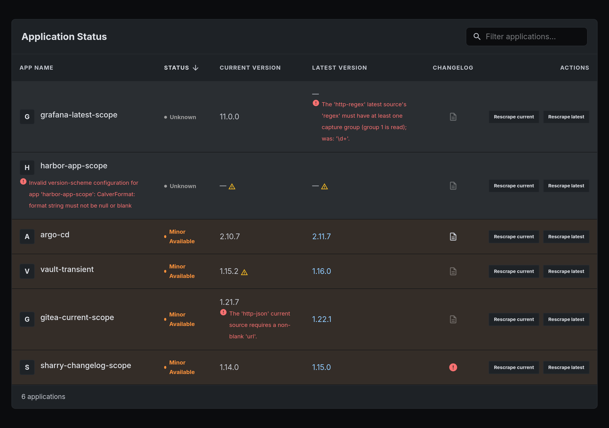

# Configuration reference

For a full working example, see
[`deploy/k8s/base/platform-config.yaml`](../deploy/k8s/base/platform-config.yaml).
Both quick starts use it. It monitors two public apps and needs no credentials.

Each current source has a tier. The tier says how much the reading can be
trusted, not what access it needs. Stick to Tier A when you can. See
[Architecture](../ARCHITECTURE.md#tiers-of-current-probes-ordered-by-trust).

## Top-level keys

| Key | Type | Required | Default | Notes |
|---|---|---|---|---|
| `scrape-interval` | duration (e.g. `1h`) | yes | — | How often the automatic full scrape runs. |
| `scrape-concurrency` | int | no | `15` | Max apps scraped in parallel during a full scrape. |
| `apps` | list of [App](#app-keys) | yes | — | The monitored fleet. |
| `scrape-trigger.max-per-window` | int | no | `10` | Max manual full scrapes (Refresh button, MCP trigger) per window. |
| `scrape-trigger.window` | duration | no | `1h` | Rolling window for `scrape-trigger`. |
| `targeted-scrape-trigger.max-per-window` | int | no | `30` | Max targeted scrapes (one app or side, used by agents) per window. Separate from `scrape-trigger` so agents cannot use up the UI's budget. |
| `targeted-scrape-trigger.window` | duration | no | `1h` | Rolling window for `targeted-scrape-trigger`. |
| `github.token` | string, env-expandable | no | absent (60 req/hr) | GitHub token used by every `github-release` source. Raises the limit to 5,000 req/hr. Usually `${GITHUB_TOKEN:}`, so an unset variable becomes empty. |
| `github.api-base-url` | string | no | `https://api.github.com` | GitHub API host for every `github-release` source. Meant for tests, not GitHub Enterprise. |

## App keys

One entry per Application under `apps[]`:

| Key | Type | Required | Default | Notes |
|---|---|---|---|---|
| `name` | string | yes | — | The Application's ID on every Surface (REST, MCP, metrics). |
| `current` | [current source](#current-sources) | yes | — | Where the running version is read. `type` picks the kind. |
| `latest` | [latest source](#latest-sources) | yes | — | Where the newest upstream version is read. `type` picks the kind. |
| `version-scheme` | `semver` \| `calver` \| `dotnet` | no | `semver` | Used by both sides, so they can always be compared. Case-insensitive. See [Version schemes](#version-schemes). |
| `calver-format` | string | if `version-scheme: calver` | — | e.g. `YY.0M.MICRO`. See [Calver format](#calver-format). |
| `dotnet-compare-build` | boolean | no | `true` | Only for `version-scheme: dotnet`. `false` compares only major and minor. See [Dotnet versions](#dotnet-versions). |
| `semver-optional-patch` | boolean | no | `false` | Only for `version-scheme: semver`; a config error on other schemes. `true` also accepts `major.minor` versions such as `12.2`. See [Semver without a patch](#semver-without-a-patch). |
| `changelog-url` | string (template) | no | absent → no link | See [Changelog link templates](#changelog-link-templates). |

## Version sources

A version source is set with `type` plus the keys for that type.

### Current sources

A current source reads the version that is running now.

| `type` | Reads the version from | Tier |
|---|---|---|
| [`http-json`](#http-json) | a field in a JSON response body | [A](../ARCHITECTURE.md#tier-a--self-reported) |
| [`http-header`](#http-header) | an HTTP response header | [A](../ARCHITECTURE.md#tier-a--self-reported) |
| [`http-prometheus`](#http-prometheus) | a label on a Prometheus metric | [A](../ARCHITECTURE.md#tier-a--self-reported) |
| [`k8s-image`](#k8s-image) | the image tag of a running container | [B](../ARCHITECTURE.md#tier-b--a-deployed-artifact-named-by-convention) |
| [`ssh-os-release`](#ssh-os-release) | `/etc/os-release` on a host, over SSH | [A](../ARCHITECTURE.md#tier-a--self-reported) |

#### `http-json`

[Tier A](../ARCHITECTURE.md#tier-a--self-reported):
needs network access only.

| Key | Type | Required | Default |
|---|---|---|---|
| `url` | string | yes | — |
| `version-key` | JSON Pointer | no | `/version` |
| `strip-prerelease` | boolean | no | `false` |
| `ca-cert` | path to PEM file | no | absent → JVM default trust |
| `insecure-skip-tls-verify` | boolean | no | `false` |
| `auth.type` | `basic` \| `bearer` | if `auth` is set | — |
| `auth.username` / `auth.password` | string | for `auth.type: basic` | — |
| `auth.token` | string | for `auth.type: bearer`, exactly one of `token`/`token-file` | — |
| `auth.token-file` | path | for `auth.type: bearer`, exactly one of `token`/`token-file` | — |

- `auth.token-file` is read again on every request, so a rotating token keeps
  working.
- `insecure-skip-tls-verify` works like `curl -k`: it skips both certificate and
  hostname checks, for this app only. It logs a WARN. It cannot be set together
  with `ca-cert`.

#### `http-header`

[Tier A](../ARCHITECTURE.md#tier-a--self-reported):
needs network access only. For apps that put their version in a response header,
such as Jenkins (`X-Jenkins`).

| Key | Type | Required | Default |
|---|---|---|---|
| `url` | string | yes | — |
| `version-header` | string | yes | — |
| `regex` | regex with ≥1 capture group | no | absent → the trimmed header value is used as-is |
| `strip-prerelease` | boolean | no | `false` |
| `ca-cert` | path to PEM file | no | absent → JVM default trust |
| `insecure-skip-tls-verify` | boolean | no | `false` |
| `auth.type` | `basic` \| `bearer` | if `auth` is set | — |
| `auth.username` / `auth.password` | string | for `auth.type: basic` | — |
| `auth.token` | string | for `auth.type: bearer`, exactly one of `token`/`token-file` | — |
| `auth.token-file` | path | for `auth.type: bearer`, exactly one of `token`/`token-file` | — |

- The status code is ignored. The header is read even from a 403 response.
- `regex` uses capture group 1 of the **first** match, not the largest.
- The header name is case-insensitive. If the header repeats, the first value
  is used.
- `auth.token-file`, `ca-cert` and `insecure-skip-tls-verify` work as in
  `http-json`.

#### `http-prometheus`

[Tier A](../ARCHITECTURE.md#tier-a--self-reported):
needs network access only. For apps that publish their version as a label on a
`*_build_info` metric, such as blackbox_exporter:

```
blackbox_exporter_build_info{branch="HEAD",goversion="go1.22.4",revision="0ec2a6b",version="0.25.0"} 1
```

| Key | Type | Required | Default |
|---|---|---|---|
| `url` | string | yes | — |
| `metric` | string | yes | — |
| `labels` | map of string → string | no | absent → every sample of `metric` matches |
| `version-label` | string | no | `version` |
| `regex` | regex with ≥1 capture group | no | absent → the trimmed label value is used as-is |
| `strip-prerelease` | boolean | no | `false` |
| `ca-cert` | path to PEM file | no | absent → JVM default trust |
| `insecure-skip-tls-verify` | boolean | no | `false` |
| `auth.type` | `basic` \| `bearer` | if `auth` is set | — |
| `auth.username` / `auth.password` | string | for `auth.type: basic` | — |
| `auth.token` | string | for `auth.type: bearer`, exactly one of `token`/`token-file` | — |
| `auth.token-file` | path | for `auth.type: bearer`, exactly one of `token`/`token-file` | — |

- The version always comes from a label, never from the sample value.
- The final response must have a 2xx status.
- `labels` is an exact-match AND selector (no `!=`, `=~` or `!~`). Use it to pick
  one installation when an endpoint serves several.
- The first matching sample in the body wins. Samples that disagree are not
  rejected.
- Both Prometheus text and OpenMetrics bodies work, including a trailing
  `# EOF`.
- `auth.token-file`, `ca-cert` and `insecure-skip-tls-verify` work as in
  `http-json`.

#### `k8s-image`

[Tier B](../ARCHITECTURE.md#tier-b--a-deployed-artifact-named-by-convention):
the tag is set when the image is built, not by the app. Needs cluster access.
See [deployment.md](deployment.md) for the
ServiceAccount and ClusterRole.

| Key | Type | Required | Default |
|---|---|---|---|
| `namespace` | string | yes | — |
| `workload` | `kind/name`, e.g. `deployment/argocd-server` | yes | — |
| `container` | string | yes | — |
| `strip-prerelease` | boolean | no | `false` |

- `kind` in `workload` must be `deployment`, `statefulset` or `daemonset`
  (case-insensitive).
- The Kubernetes client needs no config. It uses the backend's ServiceAccount
  in the cluster.

#### `ssh-os-release`

[Tier A](../ARCHITECTURE.md#tier-a--self-reported):
the OS wrote `/etc/os-release` itself. Needs SSH access.

| Key | Type | Required | Default |
|---|---|---|---|
| `host` | string | yes | — |
| `port` | int | no | `22` |
| `user` | string | yes | — |
| `private-key` | inline OpenSSH PEM | exactly one of `private-key`/`private-key-file` | — |
| `private-key-file` | path, read at connect time | exactly one of `private-key`/`private-key-file` | — |
| `host-key` | one line, e.g. `ssh-ed25519 AAAA…` | exactly one of `host-key`/`known-hosts` | — |
| `known-hosts` | path to a `known_hosts` file | exactly one of `host-key`/`known-hosts` | — |
| `release-field` | string | no | `VERSION_ID` |

There is no trust-on-first-use. You must give a host key or a `known_hosts`
file.

### Latest sources

A latest source reads the newest version published upstream.

| `type` | Reads the version from | Credentials |
|---|---|---|
| [`github-release`](#github-release) | GitHub Releases | none for public repos; `github.token` or `auth` otherwise |
| [`oci-registry`](#oci-registry) | image tags in an OCI registry | none for public repos; `auth.type: basic` otherwise |
| [`http-regex`](#http-regex) | a regex over a web page | none; `auth` if the page needs it |

Every latest source fetches through the same transport as the HTTP current
sources, so `ca-cert` and `insecure-skip-tls-verify` work as in
[`http-json`](#http-json) for all three, and `auth` does for `github-release`
and `http-regex`.

#### `github-release`

Picks the largest release by version. Skips draft and prerelease releases.

| Key | Type | Required | Default |
|---|---|---|---|
| `repo` | `owner/repo` (exactly one `/`) | yes | — |
| `page-size` | int, 1–100 | no | `30` |
| `ca-cert` | path to PEM file | no | absent → JVM default trust |
| `insecure-skip-tls-verify` | boolean | no | `false` |
| `auth.type` | `basic` \| `bearer` | if `auth` is set | — |
| `auth.username` / `auth.password` | string | for `auth.type: basic` | — |
| `auth.token` | string | for `auth.type: bearer`, exactly one of `token`/`token-file` | — |
| `auth.token-file` | path | for `auth.type: bearer`, exactly one of `token`/`token-file` | — |

- `page-size` is how many recent releases are checked. Uses the top-level
  `github.api-base-url` key.
- Without an `auth` block the top-level `github.token` is sent as a bearer
  token, if set. An `auth` block on the app wins over `github.token`.
- `auth.token-file`, `ca-cert` and `insecure-skip-tls-verify` work as in
  `http-json`.

#### `oci-registry`

Picks the largest tag over the full tag list, using the app's
`version-scheme`. Public repos get an anonymous token, like an anonymous
`docker pull`.

| Key | Type | Required | Default |
|---|---|---|---|
| `registry` | host, e.g. `registry-1.docker.io` | yes | — |
| `repo` | string | yes | — |
| `page-size` | int | no | `100` |
| `max-tags` | int | no | `1000` |
| `prerelease-filter` | string | no | absent → only tags without a prerelease part |
| `strip-prerelease` | boolean | no | `false` |
| `ca-cert` | path to PEM file | no | absent → JVM default trust |
| `insecure-skip-tls-verify` | boolean | no | `false` |
| `auth.type` | `basic` (only) | no | absent → anonymous |
| `auth.username` / `auth.password` | string | if `auth` is set | — |

- The URL is `https://{registry}/v2/{repo}`. Add `http://` or `https://` to
  `registry` to choose the scheme yourself, e.g. for a local test registry.
- Tags past `max-tags` are ignored, with a warning.
- `bearer` and `token-file` auth are not supported. The `basic` credential is
  sent to the token realm the registry advertises, not to `tags/list` itself.
- `ca-cert` and `insecure-skip-tls-verify` work as in `http-json`.
- `prerelease-filter` cannot be used with `version-scheme: dotnet`. This applies
  to any `latest` type, not only `oci-registry`.

#### `http-regex`

Fetches `url` as text. Capture group 1 of every `regex` match is a candidate.
The largest wins.

| Key | Type | Required | Default |
|---|---|---|---|
| `url` | string | yes | — |
| `regex` | regex with ≥1 capture group | yes | — |
| `ca-cert` | path to PEM file | no | absent → JVM default trust |
| `insecure-skip-tls-verify` | boolean | no | `false` |
| `auth.type` | `basic` \| `bearer` | if `auth` is set | — |
| `auth.username` / `auth.password` | string | for `auth.type: basic` | — |
| `auth.token` | string | for `auth.type: bearer`, exactly one of `token`/`token-file` | — |
| `auth.token-file` | path | for `auth.type: bearer`, exactly one of `token`/`token-file` | — |

- `auth.token-file`, `ca-cert` and `insecure-skip-tls-verify` work as in
  `http-json`.

## Version schemes

### Semver without a patch

`version-scheme: semver` is strict by default: `12.2` is rejected. Some
upstreams publish two-part versions on purpose. Jellyfin, since 12.0, tags
`v12.2` while its API reports `12.2.0`. For such an app, set
`semver-optional-patch: true`:

```yaml
- name: jellyfin
  version-scheme: semver
  semver-optional-patch: true
  changelog-url: https://github.com/jellyfin/jellyfin/releases/tag/v{version}
  current:
    type: http-json
    url: http://jellyfin.media.svc:8096/System/Info/Public
    version-key: /Version
  latest:
    type: github-release
    repo: jellyfin/jellyfin
```

- `major.minor[-prerelease][+build]` is accepted and compared as
  `major.minor.0`. `v12.2` equals `12.2.0`, so the app above is up to date.
- A version with a patch is read as normal semver. `12.2.1` is newer than
  `12.2`, and the step grades `PATCH`.
- Drift, prereleases, `prerelease-filter` and `strip-prerelease` work as for any
  semver app. `v12.0-rc7` is a prerelease; `12.2-alpine` matches the filter
  `alpine`.
- One part (`12`) and four or more parts are still rejected, so Docker Hub's
  floating `12` tag is never chosen as latest.
- The version is shown as published, minus a leading `v`. `v12.2` shows as
  `12.2`.
- Leave it off for other apps: with it on, a floating two-part registry tag such
  as `1.27` would also count as a version.
- The key is a config error on a `calver` or `dotnet` app, even set to `false`.
  It says the app is semver, so it is refused rather than ignored.

### Calver format

`calver-format` uses the calver.org tokens `YYYY`, `YY`, `0Y`, `MM`, `0M`, `WW`,
`0W`, `DD`, `0D`, `MAJOR`, `MINOR`, `MICRO` and `MODIFIER`, separated by `.`, `-`
or `_`. Examples: `YY.0M.MICRO`, `YYYY.MM.DD`.

Drift severity per token:

- **MAJOR**: year tokens and `MAJOR`.
- **MINOR**: month, week and day tokens, and `MINOR`.
- **PATCH**: `MICRO` and `MODIFIER`.

### Dotnet versions

`version-scheme: dotnet` reads `System.Version` strings:
`major.minor[.build[.revision]]`, with 2 to 4 numeric parts. Sonarr, Radarr and
Prowlarr use it (`4.0.20.3014`). A leading `v` is removed. Anything else is
rejected, for example `4`, `1.2.3.4.5`, `4.0.x` or `4.0.17-rc1`.

- Missing trailing parts count as zero, so `6.2`, `6.2.0` and `6.2.0.0` are
  equal.
- The revision is never compared. `4.0.20.3012` is up to date against
  `4.0.20.3014`.
- The build is compared by default. With `dotnet-compare-build: false` it is
  not, and the app can never show `PATCH` drift.
- Drift: major → `MAJOR`, minor → `MINOR`, build → `PATCH`.
- The version is shown as published, minus a leading `v`. `6.2` shows as `6.2`.
- `strip-prerelease` does nothing, because there is no prerelease part.
- When tags differ only by revision, they tie for latest. Which one is shown
  depends on the order of the upstream list. The status is the same either way.

## Changelog link templates

`changelog-url` is a URL template. It is filled in from the app's latest
version when the link is read. Placeholders:

| Placeholder | Allowed for |
|---|---|
| `{version}` | every scheme |
| `{major}` `{minor}` `{patch}` | `semver` |
| `{major}` `{minor}` `{build}` `{revision}` | `dotnet` (`{patch}` is not allowed) |
| any token in the app's own `calver-format`, e.g. `{YY}` `{0M}` `{MICRO}` | `calver` |

- `semver` with `semver-optional-patch`: a missing patch is filled in as `0`,
  so `12.2` gives `{patch}` = `0`. `{version}` is `12.2`.
- `dotnet`: missing parts are filled in as `0`, so `6.2` gives `{build}` = `0`
  and `{revision}` = `0`.
- `calver`: values are the text exactly as shown in the version, zero-padding
  included.
- A template with no placeholders (a fixed URL) is allowed.

## Opt-in self-monitoring

The backend's `GET /api/version` and the frontend's `GET /version.json` both
return `{"version":"1.2.3"}`. Monitor them with a normal `http-json` source.
They are not in the default config.

Add these entries to your `platform-config.apps`. Replace the host with one the
scraper can reach:

```yaml
platform-config:
  scrape-interval: 1h
  apps:
    - name: platformup2date-backend
      current:
        type: http-json
        url: https://platformup2date.example.com/api/version
      latest:
        type: github-release
        repo: sreyardship/PlatformUp2Date

    - name: platformup2date-frontend
      current:
        type: http-json
        url: https://platformup2date.example.com/version.json
      latest:
        type: github-release
        repo: sreyardship/PlatformUp2Date
```

- Both endpoints stay public with Surface authentication on. An external auth
  proxy may need bypass rules; see
  [deployment.md](deployment.md#build-version-endpoints).
- This works for tagged builds. Local `dev` and CI `dev-<commit>` builds are
  not semver, so the current scrape fails.
- `github-release` ignores RC releases, so it does not follow the RC channel.
- The build identity is set at build time, not by configuration. See
  [RELEASE.md](../RELEASE.md#embedded-build-identity).

## Surface authentication (MCP + web)

These environment variables turn on inbound OAuth 2.1 authentication for the
backend's own Surfaces. This is different from a version source's `auth.*`
keys, which are outbound credentials the scraper sends.

| Key | Type | Required | Default | Notes |
|---|---|---|---|---|
| `OIDC_ISSUER` | issuer URL | no | absent → authentication off | Setting it turns on token checks for the whole app. |
| `OIDC_AUDIENCE` | string | if `OIDC_ISSUER` is set | — | Stops tokens minted for another audience on the same issuer. |
| `MCP_OIDC_ROLE` | role name | no | absent → `/api/mcp` is open | Role needed for the MCP endpoint. Usually `pu2d-mcp`. Needs `OIDC_ISSUER`. |
| `WEB_OIDC_ROLE` | role name | no | absent → `/api/v1` is open | Role needed for the REST API and the web UI. Usually `pu2d-web`. Needs `OIDC_ISSUER`. |

- Each role variable gates its own Surface. Setting it turns the check on.
- At boot the backend logs whether authentication is enabled or disabled.
- `/metrics`, `/q/health`, `/api/version` and `/version.json` are never gated.
  See [deployment.md](deployment.md#web-ui-authentication).
- Other `quarkus.oidc.*` properties work but are not part of the contract.

## Frontend runtime configuration

The frontend reads these environment variables each time the container starts
(`docker-entrypoint.d/40-env-config.sh` writes them to `window._env_`):

| Key | Type | Required | Default | Notes |
|---|---|---|---|---|
| `API_BASE_URL` | base URL | no | `""` (same origin) | Where the SPA sends API calls. |
| `OIDC_AUTHORITY` | issuer URL | no | `""` | The IdP to log in with. Must match the backend's `OIDC_ISSUER`. |
| `OIDC_CLIENT_ID` | string | no | `""` | The SPA's public PKCE client ID. |
| `OIDC_SCOPE` | space-separated scopes | no | `openid profile` | Sent as-is in the login request. |

Login is on only when both `OIDC_AUTHORITY` and `OIDC_CLIENT_ID` are set. See
[deployment.md](deployment.md#web-ui-authentication) for IdP setup.

## When configuration is wrong

- **The backend does not start** when `platform-config` cannot load: invalid
  YAML, a missing required key, or a value of the wrong type (e.g.
  `page-size: many`). The same applies when `MCP_OIDC_ROLE` or `WEB_OIDC_ROLE`
  is set without `OIDC_ISSUER`, or `OIDC_ISSUER` is set without
  `OIDC_AUDIENCE`.
- **A bad value in one app** records a config error. The backend still starts
  and other apps are not affected. What breaks depends on the key:
  - a `current` or `latest` key → that side stops updating and keeps its last
    version;
  - `version-scheme`, `calver-format`, `prerelease-filter` on a `dotnet` app,
    or `semver-optional-patch` on a `calver` or `dotnet` app → both sides;
  - `changelog-url` → only the changelog link is hidden.
- **A valid value that finds no version** (a regex with no match, a missing
  header, an unreachable URL) makes the scrape fail. It is not a config error.

A config error stays until the config is fixed. On the board it shows as a red
icon with the reason always visible. A failed scrape shows as an amber warning
on hover.



Config errors also appear in `configErrors` in the REST and MCP
`get_application` responses, in the `list_misconfigured_applications` MCP tool,
and in the `pu2d_config_error{application, scope}` metric. See
[deployment.md](deployment.md#metrics).

## References

- [`CONTEXT.md`](../CONTEXT.md): domain terms.
- [`ARCHITECTURE.md`](../ARCHITECTURE.md): current/latest design and tiers.
- [`deployment.md`](deployment.md): Kubernetes, RBAC, metrics, and production
  authentication.
- ADRs in [`docs/adr/`](adr/):
  - Config errors: [0032](adr/0032-config-errors-degrade-per-app-never-the-boot.md),
    [0034](adr/0034-conf-check-removed-the-backend-proves-the-config.md),
    [0035](adr/0035-config-error-is-a-domain-primitive.md)
  - Version sources: [0005](adr/0005-version-sources-as-pluggable-factories.md),
    [0031](adr/0031-http-current-source-renamed-http-json.md),
    [0038](adr/0038-current-source-tiers-rank-trust-not-access.md),
    [0039](adr/0039-one-http-transport-three-extractors.md),
    [0040](adr/0040-latest-leg-on-the-shared-http-transport.md)
  - `http-json`: [0007](adr/0007-json-pointer-current-version-extraction.md),
    [0008](adr/0008-authenticated-http-current-source.md),
    [0012](adr/0012-http-current-source-file-token-and-custom-ca.md)
  - `http-header`: [0030](adr/0030-http-header-current-source.md)
  - `http-prometheus`: [0033](adr/0033-http-prometheus-current-source.md)
  - `ssh-os-release`: [0016](adr/0016-ssh-os-release-current-source.md),
    [0025](adr/0025-ssh-os-release-native-image-reachability.md)
  - `github-release`: [0010](adr/0010-github-release-latest-is-largest-semver.md),
    [0011](adr/0011-github-release-configured-by-repo-slug.md)
  - `oci-registry`: [0013](adr/0013-oci-registry-bearer-challenge-dance.md),
    [0014](adr/0014-oci-registry-latest-is-largest-semver-over-full-tag-set.md)
  - `http-regex`: [0017](adr/0017-http-regex-latest-source.md)
  - Version schemes: [0015](adr/0015-calver-as-a-first-class-version-scheme.md),
    [0022](adr/0022-version-scheme-authority-is-configuration.md),
    [0036](adr/0036-dotnet-as-a-third-version-scheme.md),
    [0041](adr/0041-semver-optional-patch.md)
  - Changelog links: [0021](adr/0021-changelog-link-is-a-template-projection.md)
  - Surface authentication: [0026](adr/0026-mcp-endpoint-oauth-resource-server.md),
    [0028](adr/0028-web-and-mcp-surfaces-role-gated-behind-one-issuer.md)
  - Build identity: [0037](adr/0037-build-identity-belongs-to-each-artifact.md)
