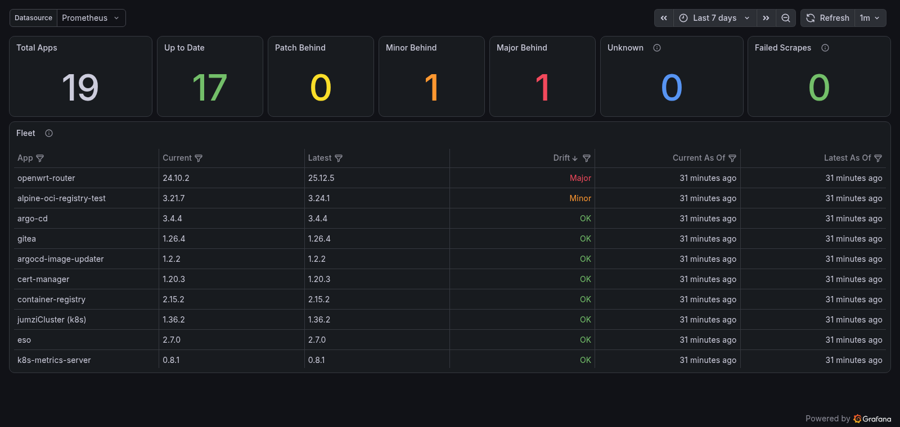

# Deploying to Kubernetes

The README quick start (`compose.quickstart.yml`) lets you try the tool on
your machine. This page tells you how to run the tool on your own cluster.

Kubernetes is the primary deployment target. The tool is developed and run on
Kubernetes. But the tool does not need Kubernetes. The two images are standard
OCI images. They run on all OCI-compatible runtimes (Docker, Podman,
containerd). The compose quick start shows this. Only the `k8s-image` current
source is specific to Kubernetes. It reads workloads from the Kubernetes API.
When the backend runs in a cluster, this source configures itself. The backend
does not have to run in the cluster that it reads. But setup is easier when it
does.

The backend is designed for high availability. All scrape state is in Valkey.
Each surface (REST, frontend, metrics, MCP) is a stateless projection of that
state. Thus, replicas are interchangeable. Run as many replicas as you want.
Session affinity is not necessary. A scrape on one replica updates the data
that all replicas serve. See
[`docs/adr/0003`](adr/0003-scrape-state-centralised-in-valkey.md) and
[`docs/adr/0004`](adr/0004-mcp-transport-stateless-for-ha.md).

## The shipped manifests

The deployable manifests are in [`deploy/k8s/`](../deploy/k8s/). They are a
kustomize tree. Only kustomize is supported. See
[`docs/adr/0027`](adr/0027-deploy-manifests-are-kustomize-only.md).

```
deploy/k8s/
├── base/                  # backend (2 replicas) + frontend, namespace-agnostic
│   └── platform-config.yaml   # the canonical sample config (a ConfigMap you replace)
├── components/
│   ├── valkey/            # bundled single-replica Valkey (quickstart datastore)
│   └── rbac/              # opt-in ClusterRole for the k8s-image source
└── overlays/
    └── quickstart/        # namespace + base + valkey + a host-less Ingress
```

### Try it on a cluster

```bash
kubectl apply -k deploy/k8s/overlays/quickstart
```

This command creates the `platformup2date` namespace. It serves the UI through
an Ingress that has no host and no class. The Ingress uses the default
IngressClass of your cluster. k3s and minikube have a default IngressClass. On
other clusters, patch `ingressClassName`. See
[`overlays/quickstart/ingress.yaml`](../deploy/k8s/overlays/quickstart/ingress.yaml)
for an example.

The routing contract is:

- `/api` goes to the backend. The path is not stripped.
- All other paths go to the frontend.

The frontend `API_BASE_URL` stays empty. Thus, browser calls are same-origin,
and CORS is not necessary.

### Run it for real: write an overlay

Use the base as a remote base. Pin it to an immutable release tag. There is no
stable release yet. Thus, this example uses the current release candidate,
`v1.0.0-rc.7`. Replace it with a stable release tag when one is available.
Review the prerelease changes before you use a release candidate in
production.

```yaml
# kustomization.yaml
apiVersion: kustomize.config.k8s.io/v1beta1
kind: Kustomization
namespace: my-namespace

resources:
  - https://github.com/sreyardship/PlatformUp2Date//deploy/k8s/base?ref=v1.0.0-rc.7
  - namespace.yaml

# Your real monitoring config, replacing the sample wholesale. The generated
# hash suffix rolls the backend automatically on every config change.
configMapGenerator:
  - name: platform-config
    behavior: replace
    files:
      - platform-config.yaml
```

Argo CD and Flux can use this file directly. It is a standard kustomization.

- **Credentials** (`GITHUB_TOKEN`, `HARBOR_USER`/`HARBOR_PASS`, …) need no
  patch. The backend Deployment has an `envFrom` entry with `optional: true`.
  It points to a Secret named `platformup2date-env`. Create the Secret. Each
  key becomes an environment variable:

  ```bash
  kubectl -n my-namespace create secret generic platformup2date-env \
    --from-literal=GITHUB_TOKEN=ghp_…
  ```

  Secrets that are files (the `ssh-os-release` private key, custom CAs) stay
  volume mounts. Add the Secret volume and a `volumeMounts` patch in your
  overlay. See [`configuration.md`](configuration.md#ssh-os-release) for the
  paths that the config expects.
- **Ingress**: the base has no Ingress. The quick start Ingress is in the
  overlay. Add your own Ingress or HTTPRoute. Obey the routing contract above.

### Valkey: bundled or bring your own

The base has **no** datastore. This is by design. The quick start adds
`components/valkey`: one replica, no persistence. This is sufficient for this
workload. Scrape state can be rebuilt. If the pod is lost, one re-scrape
restores the state. Only the fleet staleness clock and the manual-scrape
budgets reset.

For an HA datastore, run your own Valkey or Redis. An operator, a managed
service, or Sentinel are all applicable. The storage adapter uses only simple
single-key commands. Thus, standalone, Sentinel, and cluster topologies all
work. Point the backend at your datastore with an env patch:

```yaml
patches:
  - patch: |-
      apiVersion: apps/v1
      kind: Deployment
      metadata:
        name: platformup2date-backend
      spec:
        template:
          spec:
            containers:
              - name: backend
                env:
                  - name: QUARKUS_REDIS_HOSTS
                    value: redis://my-valkey:6379
```

For Sentinel, set these variables instead:

- `QUARKUS_REDIS_CLIENT_TYPE=sentinel`
- `QUARKUS_REDIS_HOSTS=redis://sentinel-0:26379,redis://sentinel-1:26379,…`
- `QUARKUS_REDIS_MASTER_NAME=<master>`

Note: with async replication, a failover can lose the last writes. Here, the
worst case is one re-scrape. The state model is designed to tolerate this.

When Valkey is not reachable, the backend fails closed. It returns HTTP 503.
Its readiness probe (`/q/health/ready`) reports DOWN. Thus, the replicas are
removed from rotation until Valkey is reachable again.

### k8s-image RBAC

Add `components/rbac` to your overlay only if an app in your config uses the
`k8s-image` current source:

```yaml
components:
  - https://github.com/sreyardship/PlatformUp2Date//deploy/k8s/components/rbac?ref=v1.0.0-rc.7
```

The component grants cluster-wide read-only `get` on Deployments,
StatefulSets, and DaemonSets. It does not grant `list`, `watch`, writes, or
access to secrets. The grant goes to the `platformup2date` ServiceAccount. The
base always creates this ServiceAccount.

**Namespace caveat**: a ClusterRoleBinding subject names one specific
namespace. The kustomize `namespace:` transformer does *not* rewrite it. It
rewrites only subjects that are named `default`. If your namespace is not
`platformup2date`, patch the subject:

```yaml
patches:
  - patch: |-
      - op: replace
        path: /subjects/0/namespace
        value: my-namespace
    target: {kind: ClusterRoleBinding, name: platformup2date-read-workloads}
```

## What the backend needs (outside Kubernetes)

You can run the backend on Docker, Podman, or another OCI runtime. The base
manifests set up two things. You must set them up yourself. The compose quick
start shows both:

- **A reachable Valkey instance** (or a Redis-API-compatible instance). All
  scrape state is in Valkey, not in the JVM. This includes the observed
  Applications, the fleet-wide staleness clock, and the manual-scrape budgets.
  Thus, each replica serves the same snapshot. But Valkey is a hard
  dependency. If Valkey is not reachable, reads and scrape triggers fail
  closed with HTTP 503. There is no per-instance cache. Point the backend at
  Valkey with `QUARKUS_REDIS_HOSTS=redis://<host>:6379`.
- **A mounted `platform-config` file.** Supply it with
  `QUARKUS_CONFIG_LOCATIONS=/config/platform-config.yaml`. The image contains
  no config. To change the monitored apps, edit the config. You do not have to
  rebuild the image. See [`configuration.md`](configuration.md) for all keys.
  The `k8s-image` current source configures itself from the in-cluster
  ServiceAccount (Fabric8). It needs the RBAC component above. It does not work
  outside a cluster. The `ssh-os-release` source needs its private key and
  known-hosts or host-key mounted. See
  [`configuration.md`](configuration.md#ssh-os-release). It does not need
  Kubernetes RBAC.

## Build-version endpoints

| Service | Request | Response |
|---|---|---|
| Backend | `GET /api/version` | `{"version":"1.2.3"}` |
| Frontend (nginx) | `GET /version.json` | `{"version":"1.2.3"}` |

Both endpoints return HTTP 200, `Content-Type: application/json`, and
`Cache-Control: no-store`. They expose only the embedded build identity. They
do not expose credentials or deployment configuration. The `/api/v1/version`
endpoint is different. It returns the statuses of the monitored Applications,
not the backend build identity.

Both endpoints are readable without authentication. This is also true when
web or MCP Surface authentication is on. The `/api/v1*` and `/api/mcp*` role
gates do not change. An external authentication proxy can still block these
endpoints. To permit version discovery without credentials through such a
proxy, configure exact-path bypasses for `/api/version` and `/version.json`.
Keep these separate from the MCP bypasses below. Obey `no-store`. Disable all
CDN or proxy caching of these paths. If you do not, the scraper can see an
earlier artifact instead of the running instance.

A new ingress rule is not necessary. `/api` goes to the backend, not stripped.
The catch-all goes to the frontend. Both shipped nginx configurations serve
`/version.json` as an exact JSON location. If the file is missing, nginx
returns HTTP 404, not the SPA shell with HTTP 200. The frontend serves its own
static identity. It does not contact the backend. Thus, the frontend endpoint
stays available when the backend is not available.

The identity belongs to **the instance that answered**. It does not belong to
all replicas or to a JavaScript bundle that a browser already loaded. During a
rolling update, successive requests can return different identities. This is
correct. There is no rollout aggregation and no consistency check. A backend
identity read needs no scrape, no Valkey access, and no upstream request. But
readiness does not change. If the Valkey readiness check of a backend fails,
the Service can remove that backend from routing. Then the backend is not
reachable through its Service.

Release identities come from the tag. The leading `v` is removed. Prerelease
and build metadata are kept. Edge builds report `dev-<full-commit>`. Local
builds report `dev`. Runtime variables, mounted config, labels, and retagging
cannot change these identities. For build-time injection, see
[RELEASE.md](../RELEASE.md#embedded-build-identity). For opt-in monitoring of
tagged builds, see
[configuration.md](configuration.md#opt-in-self-monitoring). Development
identities cannot be compared as standard semver releases.

## MCP endpoint authentication

You turn on MCP endpoint authentication with `OIDC_ISSUER` and
`OIDC_AUDIENCE`. See
[`configuration.md`](configuration.md#surface-authentication-mcp--web). This
has two effects on all components in front of the backend:

- **The shared `HTTPRoute` needs one more rule.**
  [`docs/adr/0002`](adr/0002-mcp-endpoint-under-api.md) says that no ingress
  change is necessary. This is true only while the endpoint has no
  authentication. The RFC 9728 protected-resource metadata is served at the
  host root (`/.well-known/oauth-protected-resource/api/mcp`). This path is
  outside the `/api` prefix. The `/api` PathPrefix rule does not match it. The
  catch-all `/` rule sends it to the frontend instead of the backend. Add a
  PathPrefix rule that sends `/.well-known/oauth-protected-resource` to the
  backend, not stripped:

  ```yaml
  apiVersion: gateway.networking.k8s.io/v1
  kind: HTTPRoute
  metadata:
    name: platformup2date
  spec:
    rules:
      - matches:
          - path:
              type: PathPrefix
              value: /api
        backendRefs:
          - name: platformup2date-backend
            port: 8080
      - matches:
          - path:
              type: PathPrefix
              value: /.well-known/oauth-protected-resource
        backendRefs:
          - name: platformup2date-backend
            port: 8080
      - matches:
          - path:
              type: PathPrefix
              value: /
        backendRefs:
          - name: platformup2date-frontend
            port: 80
  ```

  The metadata path is not moved under `/api`. A different location would
  break the URL derivation in clients. Thus, the extra rule is mandatory.

- **An edge proxy in front of the host must not block MCP.** You can keep
  `oauth2-proxy` (or a similar proxy) in front of the host for the web UI and
  REST. See the interim posture below. Then the proxy must bypass `/api/mcp`
  and `/.well-known/oauth-protected-resource*`. For oauth2-proxy, use
  `--skip-auth-route`. If the proxy does not bypass these paths, it intercepts
  the challenge and discovery requests. Then the backend cannot answer them,
  and native MCP client authentication fails.

> **DCR caveat.** Native client discovery needs *dynamic client registration*
> (DCR) on your issuer. If your issuer does not support DCR, enable it, or
> pre-register the client IDs that your MCP clients use. If you do not, the
> flow fails at registration. This is a property of your IdP, not of this
> app.

When MCP endpoint authentication is off (`OIDC_ISSUER` not set, the default),
these two changes do not apply. The endpoint then behaves as described in
[ADR 0002](adr/0002-mcp-endpoint-under-api.md).

## Web UI authentication

The web UI and the REST API (`/api/v1`) use the same issuer as MCP. They have
their own role variable, `WEB_OIDC_ROLE`. It has no default. The conventional
value is `pu2d-web`. See
[`configuration.md`](configuration.md#surface-authentication-mcp--web). If
you do not set the variable, the surface stays open. When you turn it on, the
cluster-level effects are different from MCP:

- **No ingress change is necessary.** MCP needs the
  `/.well-known/oauth-protected-resource` HTTPRoute rule above. The SPA does
  not. The SPA finds the IdP from its own runtime config
  (`OIDC_AUTHORITY`/`OIDC_CLIENT_ID`). These values go into `window._env_`,
  the same way as `API_BASE_URL`. The web surface has no server-side
  protected-resource metadata document. Thus, no new route at the host root is
  necessary. The `/api` PathPrefix rule (not stripped, to the backend) and the
  catch-all `/` rule (to the frontend) do not change.
- **Web auth gates `/api/v1`, not the SPA static shell.** The frontend
  `Service` and `Deployment` serve the page to everyone. The JS bundle must
  load and run before it can send an anonymous visitor to the IdP. A BFF or an
  edge proxy in front of the host *can* hide the page. This SPA-as-OIDC-client
  topology cannot. See
  [ADR 0028](adr/0028-web-and-mcp-surfaces-role-gated-behind-one-issuer.md).
  If you must hide the page, use an edge proxy. This feature does not do it.
- **These endpoints stay open** when web auth is on or off: `/metrics`,
  `/q/health`, the OpenAPI spec (`/q/openapi`), and the build-version
  endpoints (`/api/version`, `/version.json`). No Surface role gate touches
  them.
- **Dev-mode CORS**: in dev, the Vite dev server serves the SPA from
  `localhost:3000`. Quarkus serves the API from `localhost:8080`. This is a
  cross-origin request. It occurs in dev only. The `%dev` CORS block in
  `application.yml` pins `origins` to that exact dev origin. It never uses
  `*`. It permits the `authorization` header, so the bearer token can be
  attached. Production is same-origin behind `/api`. It does not need CORS.
- **An edge proxy in front of the host must still bypass the MCP paths**
  (as above). This applies if you keep a proxy for defense-in-depth after web
  auth is in the app. The two mechanisms are independent. They can be used
  together. But the proxy must not intercept `/api/mcp` or the well-known
  path.

The SPA uses Authorization Code + PKCE (`oidc-client-ts` /
`react-oidc-context`). It holds the access token in memory only. It never uses
`localStorage` or `sessionStorage`. It renews the token silently in the
background. If the token of a caller does not have the role, the SPA shows a
*Not authorized* screen with a log-out action. This is a 403 from the backend,
not a login failure.

**IdP prerequisites.** Register the SPA in your IdP as a **public client with
PKCE**. Do not set a client secret. Configure these items:

- Redirect URI: the origin of the SPA, with path `/` (for example
  `https://platformup2date.example.com/`).
- A matching post-logout (end-session) redirect URI. Log-out is RP-initiated.
  It ends the IdP session, not only the local token.
- Silent renew (refresh). Enable it, so that a page reload does not cause a
  full re-login.
- The `pu2d-web` role (or the value of `WEB_OIDC_ROLE`). Grant it as a realm
  or group role to the users who can use the app. The role is what admits a
  caller. Authentication against the IdP alone is not sufficient.

If you do not set `WEB_OIDC_ROLE` (or `OIDC_ISSUER`), protect the web UI and
the REST API in another way. Use an edge proxy such as `oauth2-proxy` in
front of the host, or a private network.

## Metrics

The backend exposes a Prometheus scrape endpoint at `/metrics`. The backend
renders the Prometheus text exposition format itself. It does not use
Micrometer. Six metric families are exported:

- `pu2d_application_info` — fleet membership and the current and latest
  version strings.
- `pu2d_version_drift_level` — how far the deployed version is behind the
  latest version. `0` = current, `1` = patch, `2` = minor, `3` = major. A
  difference in the pre-release part reports `1`. A difference in the build
  metadata only is ignored and reports `0`. Calver apps grade by the category
  of the changed token: year → `3`, month/week/day → `2`, micro/modifier →
  `1`. See [`configuration.md`](configuration.md#calver-format). Dotnet apps
  grade by the changed component: major → `3`, minor → `2`, build → `1`. A
  difference in the revision only is ignored and reports `0`. See
  [`configuration.md`](configuration.md#dotnet-versions).
- `pu2d_scrape_last_success_timestamp_seconds` — freshness, per app and side.
- `pu2d_scrape_last_failure_timestamp_seconds` — failures, per app and side.
- `pu2d_config_error` — one series per recorded configuration defect
  (ADR-0032). The labels are `application` and `scope` (`CURRENT`, `LATEST`,
  `APP`, or `CHANGELOG`). A clean fleet emits no series. Thus,
  `sum(pu2d_config_error) > 0` is the alert. The reason is not a label. This
  is by design. Free-form operator text would make the cardinality too large.
  The board and the `list_misconfigured_applications` MCP tool give the
  reason. Note: this family uses the label `application`. The other families
  use the label `app`. To join it to `pu2d_application_info`, use
  `label_replace`.
- `pu2d_config_unnamed_apps` — a count without labels. It counts apps that
  were bound without a `name` and were dropped from the fleet. They have no
  identity to label. Thus, this count is the only signal that they exist.

```
# HELP pu2d_version_drift_level How far the deployed version is behind latest (0=current, 1=patch, 2=minor, 3=major)
# TYPE pu2d_version_drift_level gauge
pu2d_version_drift_level{app="argo-cd"} 3
pu2d_version_drift_level{app="git-tea"} 0
```

### Scraping with Prometheus Operator

Point a `ServiceMonitor` at the HTTP port of the backend `Service`:

```yaml
apiVersion: monitoring.coreos.com/v1
kind: ServiceMonitor
metadata:
  name: platformup2date
  labels:
    release: prometheus  # match your Prometheus Operator's serviceMonitorSelector
spec:
  selector:
    matchLabels:
      # These match the backend Service shipped in deploy/k8s/base — the
      # component label matters, or Prometheus also scrapes the frontend
      # Service (same name label, same `http` port name, no /metrics).
      app.kubernetes.io/name: platformup2date
      app.kubernetes.io/component: backend
  endpoints:
    - port: http
      path: /metrics
      interval: 1m
```

### Example alert rules

Here are two starting points. One alert fires when an app is a major version
behind. One alert fires when scraping has stopped. With the default
`scrape-interval: 1h`, a success timestamp older than six hours means
approximately six missed scrapes:

```yaml
groups:
  - name: platformup2date
    rules:
      - alert: AppMajorVersionBehind
        expr: pu2d_version_drift_level >= 3
        for: 6h
        labels:
          severity: warning
        annotations:
          summary: '{{ $labels.app }} is a major version behind its latest upstream release'

      - alert: AppConfigError
        expr: sum(pu2d_config_error) > 0
        labels:
          severity: warning
        annotations:
          summary: '{{ $value }} configuration defect(s) detected; check the board or list_misconfigured_applications for the reason'

      - alert: AppScrapeStale
        expr: time() - pu2d_scrape_last_success_timestamp_seconds > 6 * 3600
        labels:
          severity: warning
        annotations:
          summary: 'No successful {{ $labels.side }} scrape for {{ $labels.app }} in over 6h'
```

Adjust the thresholds to your own scrape interval and your own tolerance.

## Grafana dashboard

A default dashboard is in this repo at
[`grafana/platform-up-2-date.json`](../grafana/platform-up-2-date.json). It is
as near to the frontend as possible. If you already run a full Prometheus and
Grafana stack, you can choose to not deploy the frontend.



## Container images

The images are published to GHCR on each merge to `main` (`:edge`, moving) and
on each `v*` tag (`:X.Y.Z` / `:X.Y` / `:X` / `:latest`):

- `ghcr.io/sreyardship/platformup2date/backend`
- `ghcr.io/sreyardship/platformup2date/frontend`

The frontend image injects `API_BASE_URL` into `window._env_` at container
start (`docker-entrypoint.d/40-env-config.sh`), not at build time. Set it as a
standard environment variable on the container or Pod. Point it at the address
where a browser can reach the backend.
